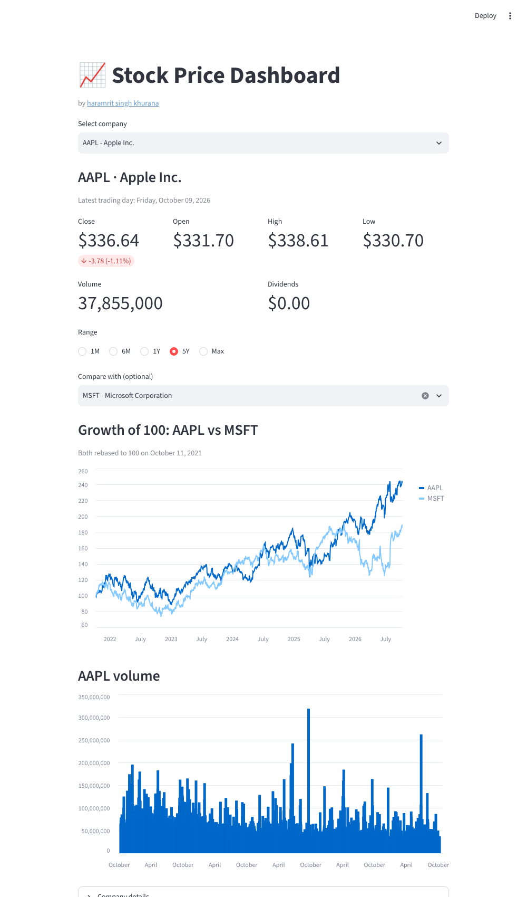
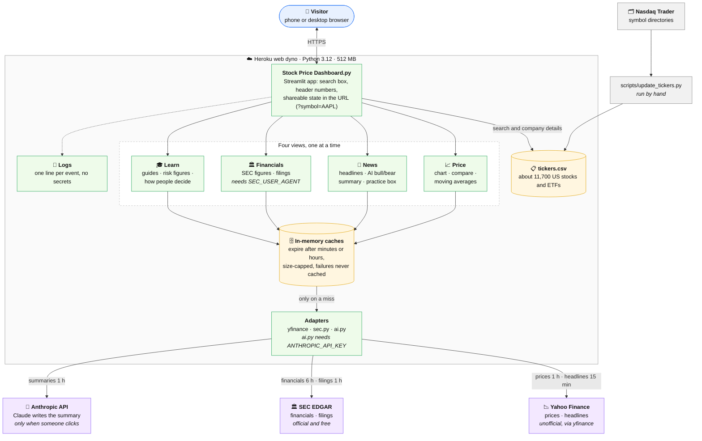
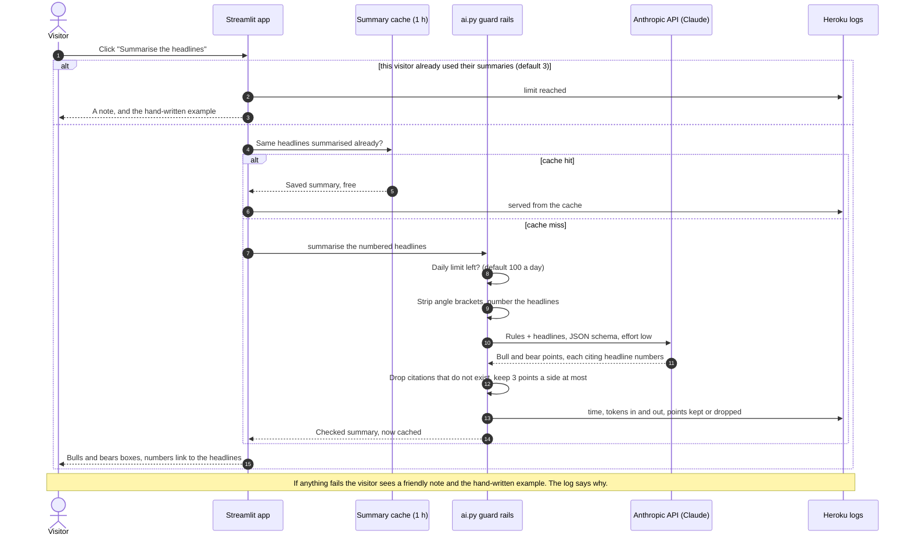

# Stock Price Dashboard

A small Streamlit app for looking up the price history of ~11,700 US-listed stocks and ETFs.
Pick a company and see the latest trading day's figures, a closing-price chart with a
1M / 6M / 1Y / 5Y / Max range picker, and trading volume. Data comes from Yahoo Finance
via [yfinance](https://github.com/ranaroussi/yfinance).

- **Financials view** (when configured): real annual revenue, net income and earnings per share from the SEC's EDGAR data, a year-by-year chart, and links to the latest 10-K, 10-Q and 8-K filings.
- **News view:** recent headlines for the company (from Yahoo Finance) with the source, how long ago, and a guessed topic, an optional **AI summary of what bulls and bears are saying** (each point cites the headlines it used), an example of reading one headline both positively and negatively, and a "try it on a real headline" practice box with the questions people ask.
- **Learn view:** plain-English explainers that use the company on screen: how to read the numbers and charts, and how to read company reports (10-K, 10-Q, 8-K, the three financial statements, earnings calls, with a link to the company's SEC filings), and how people make decisions (business value, price patterns, news, risk, mindset), with live figures such as the biggest fall and the rise needed to recover from it. Hover the **?** icons for short explanations of each number.
- **Moving averages:** switch on the 50-day and 200-day averages on the price chart.
- **Search:** type a symbol or company name and press Enter; matches are ranked with exact symbols first.
- **Compare:** pick a second company to overlay both on one chart, rebased to 100 so growth is comparable.
- **Shareable links:** the URL keeps your selection, e.g. `?symbol=AAPL&compare=MSFT&range=5Y`, so you can send someone the exact view.



### How it works

**The big picture.** One small Streamlit app on a Heroku dyno. It reads three outside services (Yahoo Finance, the
SEC, and optionally Anthropic's API) through caches, so a repeat view costs nothing and memory stays bounded.
The two features that need credentials are **off unless configured**.



**What happens when someone clicks "Summarise the headlines".** This is the one flow with several safeguards, so
it is worth spelling out. The model only ever sees the headlines on the page, and nothing it says is shown until
the app has checked it.



**How long things are kept.** Every cache has an expiry and a size cap (the oldest entries are dropped first), and
a failed or empty answer is never cached, so a brief outage can't stick.

| Data | Source | Kept for | Most entries |
| --- | --- | --- | --- |
| Price history | Yahoo Finance | 1 hour | 100 (about 100 MB at most) |
| Headlines | Yahoo Finance | 15 minutes | 200 |
| SEC company list | SEC EDGAR | 24 hours | 1 |
| Financials | SEC EDGAR | 6 hours | 100 |
| Filing lists | SEC EDGAR | 1 hour | 100 |
| AI summaries | Anthropic API | 1 hour | 200 |

**Where things live**

| File | What it does |
| --- | --- |
| `Stock Price Dashboard.py` | The app: search, the four views, caches, URL sharing and logging |
| `ai.py` | The AI summary: prompt, limits, checks on the answer, logging |
| `sec.py` | The SEC EDGAR client: annual financials and recent filings (no Streamlit code) |
| `layout.py` | A number grid that wraps to fit a phone |
| `tickers.csv`, `scripts/update_tickers.py` | The company list, and the script that rebuilds it |
| `tests/` | The automated tests (no network or API key needed) |
| `Procfile`, `setup.sh`, `requirements.txt`, `.python-version` | How Heroku builds and starts the app |

**Choices worth knowing about**
- **Optional features stay off until configured.** With no environment variables the app is just the price, news
  and learn views, so a fresh deploy can't break on a missing key.
- **The AI is boxed in.** It sees only the numbered headlines, it must cite them by number, the app drops any
  citation that doesn't exist, and there are per-visit and daily limits with a hand-written fallback.
- **Failures are loud in the log and quiet on the page.** Visitors see a short friendly note; the log line says
  what failed and what to check.
- **The weakest link is Yahoo Finance.** `yfinance` uses an unofficial endpoint: fine for a portfolio project,
  and the first thing to replace with a licensed data source if the app ever grows or earns money.

### Run locally

```bash
pip install -r requirements.txt
streamlit run "Stock Price Dashboard.py"
```

### Configuration (environment variables)

Everything below is optional; the app runs without any of it. Set them where the app runs (for example Heroku
*Settings → Config Vars*), never in the code.

| Variable | What it does |
| --- | --- |
| `SEC_USER_AGENT` | Turns on the **Financials** view. The SEC requires every program to identify itself, so use a project name and a monitored contact address, e.g. `Stock Price Dashboard you@example.com`. Use an address made for the project rather than a personal one. |
| `ANTHROPIC_API_KEY` | Turns on the AI summary in the **News** view. Without it, or when the limits below are reached, the app shows a hand-written example instead. |
| `AI_MODEL` | Model used for the summaries. Default `claude-haiku-5-5`; `claude-sonnet-5-5` and `claude-opus-5-5` are stronger. Measured on a live Sonnet call with 8 headlines: 1,364 input and 516 output tokens. At the published prices that is about $0.0004 on Haiku, $0.008 on Sonnet and $0.016 on Opus per fresh summary (assuming similar token counts across models; the log's `AI summary ok … tokens in=… out=…` line shows the real numbers for yours). Repeat clicks on the same headlines are cached and free. |
| `AI_DAILY_LIMIT` | Most fresh AI summaries per day for the whole app (default `100`). Results are cached per set of headlines, so repeat clicks don't count. Also set a spend limit in your Anthropic console. |
| `AI_SESSION_LIMIT` | Most summaries one visitor can request per visit (default `3`). |

The AI only ever sees the headlines shown on the page (no visitor data), and its answer is checked: any citation that
doesn't match a real headline is dropped.

### Reading the logs

Heroku keeps the app's recent log for free, with no add-on: `heroku logs --tail -a <app>` (or the dashboard's
**More → View logs**). The app writes one short line per important event, never a secret and never the SEC contact
address. Lines start with `INFO` or `WARNING`; a `WARNING` means something failed and says what to check.

| Line (shortened) | Meaning and what to do |
| --- | --- |
| `Starting: python 3.12…, streamlit …, anthropic …` | The app started. Check the versions here first if something behaves oddly. |
| `Financials view: on / off (SEC_USER_AGENT is not set)` | Whether the Financials view is switched on. |
| `AI summaries: on, model='claude-haiku-5-5', daily limit=50` | The AI is on and exactly which model name is used. Everything is cleaned (spaces, quotes, look-alike dashes), and if it was changed you will see `AI_MODEL was cleaned up: raw value '…'` with hidden characters written as `\uXXXX`. |
| `AI summaries: off (ANTHROPIC_API_KEY is not set)` | No key, so the AI box is hidden. |
| `… NOT one of claude-haiku-5-5, …: check AI_MODEL for typos` | The model name isn't one the app knows. It still tries it, but a 404 below means it's wrong. |
| `AI summary: calling the model for AAPL (… 3 of 50 used today)` | A real model call started and counts toward the daily limit. |
| `AI summary ok for AAPL: 2.1s, tokens in=… out=…, arguments kept 3 of 3` | It worked, with time and token usage (that is your cost). "kept 2 of 3 … dropped" means the model cited a headline that doesn't exist and the app removed that point. |
| `AI summary: served AAPL from the cache` | Someone clicked again for the same headlines: no model call, no cost. |
| `AI summary FAILED … HTTP status 404 … check AI_MODEL` | The model name wasn't found: fix `AI_MODEL`. |
| `AI summary FAILED … HTTP status 401 … check ANTHROPIC_API_KEY` | The key was rejected: re-create it and re-set it. |
| `AI summary FAILED … out of credit … Plans & Billing` | The Anthropic account has no credit (the API reports this as an invalid request, HTTP 400). Add credit in the console. |
| `AI summary FAILED … HTTP status 429 … rate limited` | Too many requests too quickly, or a usage limit was hit; check the limits in the Anthropic console. |
| `AI summary skipped … daily limit … (AI_DAILY_LIMIT)` | The app-wide daily cap was reached; visitors see the hand-written example. |
| `… this visitor has used all 3 summaries (AI_SESSION_LIMIT)` | One visitor hit the per-visit cap. |
| `SEC financials FAILED … HTTP 403 …` | The SEC rejected the request: `SEC_USER_AGENT` is missing its contact address or is malformed. |
| `SEC financials FAILED … HTTP 429 …` | Too many requests to the SEC too quickly; it clears by itself. |
| `SEC has no financial data for SPY …` | Normal for ETFs and many foreign companies. |
| `Yahoo price history FAILED for X: …` / `Yahoo news FAILED …` | Yahoo couldn't be reached or answered badly (Yahoo is an unofficial source and does this now and then). |
| `Yahoo has no price data for X` | The symbol is delisted or unknown to Yahoo. |

Heroku keeps roughly the last 1,500 lines for about a week. After changing a config var the app restarts, so the
`Starting` lines at the top of the log are the quickest check that the new value was picked up.

### Tests

```bash
pip install pytest
python -m pytest tests
```

### Updating the list of companies

`tickers.csv` is generated from Nasdaq's official symbol directories. To refresh it:

```bash
python scripts/update_tickers.py
```

### Python libraries used
- streamlit
- pandas
- yfinance
